<picture>
  <source media="(prefers-color-scheme: dark)" srcset="assets/banner-dark.svg">
  <source media="(prefers-color-scheme: light)" srcset="assets/banner-light.svg">
  
</picture>

  
  
  

## About

I'm a final-year **Data Science** student at TU Eindhoven. Before that I studied **Industrial Product Design** at Fontys, so I care about how something looks and feels as much as whether the model behind it works.

Most of my work is in Python and R: machine learning, time series, statistics and data visualisation. Outside of coursework I build small tools I actually want to use, such as browser extensions, web apps and bots.

## Featured work

<table>
<tr>
<td width="50%" valign="top">

**[Unmasking Style](https://github.com/bilginn7/language-and-ai)** 
NLP · scikit-learn · spaCy 
This paper asks whether stylometry still predicts a Reddit author's gender once label-aligned and topical words are masked out. The pipeline is fully reproducible and splits the data by author.

</td>
<td width="50%" valign="top">

**[London burglary forecasting](https://github.com/bilginn7/4CBLW00-20-Group1)** 
LightGBM · XGBoost · CatBoost · SHAP · GeoPandas 
Predicts burglary counts per LSOA from demographic, housing, spatial and temporal features. Models are tuned with Optuna and explained with SHAP.

</td>
</tr>
<tr>
<td width="50%" valign="top">

**[Sidebar Peek](https://github.com/bilginn7/sidebar-peek)** 
JavaScript · Manifest V3 · Edge extension 
Hover a channel in Twitch's sidebar to get a small, muted live preview of the stream. It collects no data.

</td>
<td width="50%" valign="top">

**[Screen time vs. sleep](https://github.com/bilginn7/JBM170-Sleep-Analysis)** 
Python · wearables · self-experiment 
A 7-week pre/post study with 5 participants. The pipeline brings data from Mi Band, Garmin and Apple Watch exports into one format.

</td>
</tr>
<tr>
<td width="50%" valign="top">

**[DBSCAN benchmark](https://github.com/bilginn7/dbscan-report)** 
Algorithms · spatial indexing 
Compares three DBSCAN implementations (linear, quadtree and box graph) on runtime and result quality across synthetic datasets.

</td>
<td width="50%" valign="top">

**[k-means initialisation & outliers](https://github.com/bilginn7/JBI045-report1)** 
Clustering · S&amp;P 500 
Tests how outlier stocks affect random, k-means++ and Gonzalez initialisation when stocks are clustered by return and volatility.

</td>
</tr>
</table>

Also contributed to <a href="https://github.com/ChrisWeijers/RailroadIncidents">RailroadIncidents</a>, an interactive Dash dashboard of U.S. railroad incidents.

## Currently building

- **Defrost My Car**: a snowy little game I'm working on. The repo is private for now.

## Toolbox

**Languages** 

**Data & ML** 

**Viz & web** 

**Design & tools** 

 

<picture>
  <source media="(prefers-color-scheme: dark)" srcset="https://raw.githubusercontent.com/bilginn7/bilginn7/output/github-snake-dark.svg">
  <source media="(prefers-color-scheme: light)" srcset="https://raw.githubusercontent.com/bilginn7/bilginn7/output/github-snake.svg">
  
</picture>
